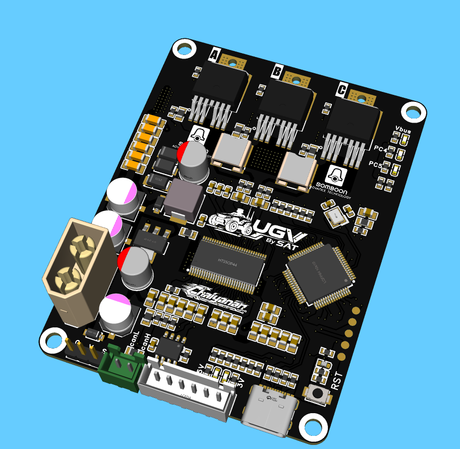
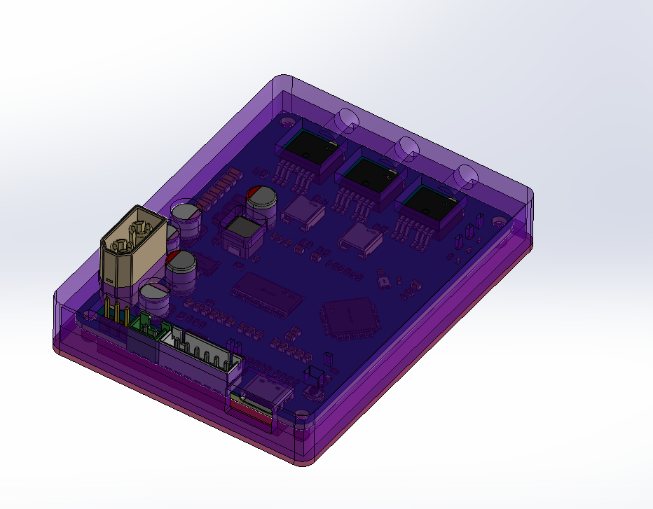

**ภาษา:** [English](README.md) · ไทย

repository นี้เผยแพร่ไฟล์เฟิร์มแวร์และฮาร์ดแวร์ ใช้ลิงก์ด้านบนเพื่อสลับภาษาเอกสารของโปรเจกต์

<div align="center">

<a href="hardware/README.md"></a>

# ESC-FOC-Driver-V3.0

**STM32F405 + DRV8302 three-phase BLDC/PMSM motor driver พร้อม custom VESC firmware, ผลตรวจ ADC และโมเดลเคส SolidWorks**


[Hardware & Schematic](hardware/README.md) · [Firmware](#firmware-ที่มีในโปรเจกต์) · [ผลตรวจ](#สถานะการทดสอบล่าสุด) · [3D & Enclosure](#โมเดล-3d-และเคส) · [เริ่มใช้งาน](#เริ่มใช้งานบน-bench)

</div>

---

## ภาพรวมโปรเจกต์

บอร์ดควบคุมมอเตอร์สามเฟสสำหรับพัฒนาและทดสอบ BLDC/PMSM โดยใช้ **STM32F405RGT6** ร่วมกับ **DRV8302** และ firmware ที่ปรับจาก VESC 6.00 สำหรับวงจร `vesc4_12B02` โปรเจกต์รวม schematic, firmware พร้อมแฟลช, source snapshot, ผลตรวจบอร์ด และแบบประกอบทางกลไว้ในที่เดียว

เอกสารนี้จัดรูปแบบต่อจาก [ESC-FOC-Drive-V02](https://github.com/poommyroboticcamera-netizen/ESC-FOC-Drive-V02) ส่วนไฟล์ firmware และ pin mapping ใน repo นี้เป็นของบอร์ด DRV8302 B02 โดยเฉพาะ

> [!IMPORTANT]
> **สถานะ ณ 19 ตุลาคม 2026: อยู่ระหว่าง bring-up และตรวจปัญหา ADC** รุ่นที่คืนลงบอร์ดและตรวจอ่านผ่าน USB ล่าสุดคือ `DRV8302_B02_R2` อ่านสถานะ FOC และ `FAULT_CODE_NONE` ได้ แต่ยังพบความแกว่งของ ADC และยังไม่ได้ยืนยันการขับมอเตอร์ ห้ามตีความสถานะ idle ที่ไม่มี fault ว่าผ่าน Motor Detection หรือพร้อมขับโหลดแล้ว

## Hardware overview

| รายการ | รายละเอียด |
|:--|:--|
| MCU | STM32F405RGT6, crystal 8 MHz |
| Gate driver | Texas Instruments DRV8302 |
| Power stage | Three-phase MOSFET bridge |
| Current sense | 2 shunts, 0.5 mΩ; amplifier gain 10 V/V |
| Current ADC | BR_SO1 → PB1 / ADC9, BR_SO2 → PB0 / ADC8 |
| Bus / phase divider | 39 kΩ / 2.2 kΩ ตาม hardware profile |
| FET temperature | NTC 10 kΩ B3450 พร้อม resistor 10 kΩ |
| Firmware interface | VESC Tool ผ่าน USB; SWD สำหรับแฟลชและ debug |
| Schematic | [SCH_SchematicV01_2_2026-10-19.pdf](hardware/schematic/SCH_SchematicV01_2_2026-10-19.pdf) |

ค่าข้างต้นเป็นข้อมูลวงจรและ configuration สำหรับเริ่มทดสอบ ยังไม่มีพิกัดกำลังต่อเนื่องหรือผลทดสอบความร้อนที่ยืนยันแล้ว

## Firmware ที่มีในโปรเจกต์

| รุ่น / ชุดไฟล์ | ใช้สำหรับ | สถานะ |
|:--|:--|:--|
| [B02 initial package](output/firmware/DRV8302_B02/) | Firmware, factory HEX รวม bootloader, BIN, ELF, map และ source ต้นรอบ | เก็บชุดต้นฉบับสำหรับอ้างอิง |
| [B02 R2](output/firmware/DRV8302_B02_R2/) | ADC prescaler /4, 21 MHz | คืนลงบอร์ดและตรวจ USB ล่าสุด; ปัญหา ADC ยังอยู่ |
| [R3](output/firmware/DRV8302_B02_R3/) | ทดลอง acquisition time | คัดออก: timing ของ ADC rank ไม่ตรงกัน |
| [R4](output/firmware/DRV8302_B02_R4/) | ปรับ ADC rank timing ให้ตรงกัน | ยังพบพีก |
| [R5](output/firmware/DRV8302_B02_R5/) | ทดลอง ADC 10.5 MHz | ยังพบพีก |
| [R6](output/firmware/DRV8302_B02_R6/) | Currents first / half-DMA interrupt | ยังพบพีก |

**B02 initial package เป็นชุดเตรียมแฟลชต้นรอบ ไม่ใช่ R2** เอกสารและ checksum ภายในชุดนั้นเก็บตามเวลาที่สร้าง ส่วนสถานะล่าสุดให้อ่าน [ผลเปรียบเทียบ ADC](output/firmware/diagnostics/ADC_COMPARISON_TH.md) และ [recovery verification](output/firmware/diagnostics/recovery_verified.json)

- [คู่มือแฟลช B02 ครั้งแรก](output/firmware/DRV8302_B02/README_TH.md)
- [Source snapshot รวมการแก้ไข diagnostic](firmware/source/vesc-6.00-b02-diagnostic-source.zip)
- [วิธีเตรียม source และ build](firmware/README.md)
- [SHA-256 ของไฟล์ในโปรเจกต์](SHA256SUMS.txt)

## ค่าเริ่มต้นสำหรับ commissioning

| ค่า | Configuration เริ่มต้นของ B02 |
|:--|:--|
| Motor current | +5 / -2 A |
| Input current | +2 / -0.5 A |
| Absolute current fault | 10 A |
| Voltage limits | 10–30 V |
| Battery cut start / end | 11 / 10 V |
| Duty สูงสุด | 20% |
| Speed limit | ±10,000 ERPM |
| Power limit | +50 / -10 W |
| FET temperature limit | เริ่มลดที่ 60 °C, สิ้นสุดที่ 75 °C |
| External app | APP_NONE |

ค่าตารางเป็น software limits ใน header ไม่ใช่พิกัดฮาร์ดแวร์ และ configuration ที่บันทึกอยู่บนบอร์ดหรือเขียนจาก VESC Tool สามารถแทนค่าเริ่มต้นได้ ต้องอ่านกลับก่อนทดสอบทุกครั้ง

## สถานะการทดสอบล่าสุด

| หัวข้อ | ผลที่มีหลักฐาน |
|:--|:--|
| Flash / read-back | คืน R2 และ verify สำเร็จ |
| USB communication | อ่านชื่อ `DRV8302_B02_R2` และ firmware 6.00 ได้ |
| Motor configuration | อ่านกลับเป็น FOC |
| Idle fault | `FAULT_CODE_NONE` ณ การตรวจหลัง recovery |
| Bus voltage | ประมาณ 24 V ตาม telemetry |
| ADC current sampling | ยังแกว่งและมีพีกเกินเกณฑ์ fault เมื่อแปลงตามสเกล firmware |
| Independent ADC | ยังพบความแกว่งที่ SO1, SO2 และ VREFINT แม้ไม่มี DMA/USB/PWM |
| Motor Detection / ขับโหลด | ยังไม่ยืนยัน |

ข้อมูลจาก ADC ที่แปลงเป็นแอมแปร์ **ยังไม่ใช่กระแสจริงที่วัดด้วย current probe** ต้องตรวจ VDDA/VSSA, reference, decoupling และเส้นทางสัญญาณเพิ่มเติม ประวัติ fault ช่วง boot มี DRV และ UNDER_VOLTAGE ซึ่งยังต้องหาสาเหตุ

อ่าน [รายงานตรวจรอบแรก](output/firmware/diagnostics/RESULT_TH.md), [ผลเปรียบเทียบและ independent ADC](output/firmware/diagnostics/ADC_COMPARISON_TH.md) และ [ข้อมูลดิบทั้งหมด](output/firmware/diagnostics/)

## โมเดล 3D และเคส

<div align="center">

</div>

ไฟล์จากโฟลเดอร์ 3D ของโปรเจกต์อยู่ใน [hardware/mechanical](hardware/mechanical/):

- [caseV03.SLDASM](hardware/mechanical/caseV03.SLDASM) — assembly ของเคส
- [pro.SLDASM](hardware/mechanical/pro.SLDASM) — assembly อีกชุดของโปรเจกต์
- ไฟล์ชิ้นส่วน `.SLDPRT`, แบบแลกเปลี่ยน `.STEP` และ mesh `.STL` ที่มีในโฟลเดอร์ต้นทาง

ใช้ SolidWorks เปิด assembly และค้นหา references จากโฟลเดอร์เดียวกัน หาก assembly อ้างถึงชิ้นส่วนภายนอกที่ไม่มีในชุดนี้จะต้องเชื่อมโยงไฟล์เพิ่มเติม ยังไม่ได้ตรวจ rebuild assembly หรือรับรองความพอดีของชิ้นงานจริง

## เริ่มใช้งานบน bench

1. ดาวน์โหลดหรือ clone โปรเจกต์ แล้วอ่าน [คู่มือฮาร์ดแวร์](hardware/README.md) และ [ข้อจำกัดการทดสอบ](output/firmware/diagnostics/ADC_COMPARISON_TH.md)
2. ถอดมอเตอร์และสายรับคำสั่ง ตรวจวงจรลัดวงจรและ rail 3.3 V ก่อนใช้แหล่งจ่ายแบบจำกัดกระแส
3. ต่อ ST-Link ผ่าน SWDIO / SWCLK / GND / NRST / VTref ตามคู่มือ ห้ามป้อน 5 V เข้าขา 3.3 V
4. เลือก firmware ให้ตรง revision: factory HEX ของ B02 มี bootloader; HEX ของ R2–R6 เป็นไฟล์ firmware สำหรับการทดลองแต่ละรุ่น
5. อ่านขั้นตอนแฟลชก่อนดำเนินการ สคริปต์ first install มี full-chip erase ซึ่งลบ configuration เดิมทั้งหมด
6. หลังแฟลช อ่านชื่อ hardware, motor/app configuration, fault, bus voltage และ current offset กลับด้วย VESC Tool ที่รองรับ firmware 6.00
7. แก้และตรวจยืนยันสัญญาณ ADC รวมถึง gate PWM/dead time ก่อนทำ Motor Detection หรือสั่งหมุน

> [!WARNING]
> บอร์ดยังอยู่ระหว่างพัฒนา ใช้แหล่งจ่ายจำกัดกระแสและเตรียมตัดไฟได้ทันที Bench supply ทั่วไปอาจรับพลังงานจาก regenerative braking ไม่ได้ ค่า regen limit ใน firmware ไม่รับประกันการป้องกัน bus overvoltage

## โครงสร้างโปรเจกต์

```text
├── hardware/
│   ├── schematic/          # Schematic PDF
│   └── mechanical/         # SolidWorks, STEP, STL
├── firmware/
│   └── source/             # VESC source snapshot + custom profiles
├── output/firmware/
│   ├── DRV8302_B02/        # Initial firmware / bootloader package
│   ├── DRV8302_B02_R2/     # Revision ที่ตรวจ USB ล่าสุด
│   ├── DRV8302_B02_R3–R6/  # Experimental revisions (แยกโฟลเดอร์จริง)
│   └── diagnostics/        # รายงานและข้อมูลการตรวจ
├── tools/                  # Build และ diagnostic scripts จากรอบพัฒนา
├── docs/assets/            # ภาพบอร์ดและเคส
└── SHA256SUMS.txt
```

## Source และสิทธิ์การใช้งาน

VESC firmware อ้างอิง [vedderb/bldc commit 4b822f0](https://github.com/vedderb/bldc/tree/4b822f0f944918957c55391ca0672925153f3fde) และ [VESC bootloader](https://github.com/vedderb/bldc-bootloader) โดยเก็บ commit ของ bootloader ใน [bootloader_commit.txt](output/firmware/DRV8302_B02/bootloader_commit.txt) เฟิร์มแวร์ VESC และการแก้ไขที่เกี่ยวข้องใช้ GPL-3.0-or-later ตามหัวไฟล์เดิม ส่วนไลบรารียังคง license ของแต่ละส่วนไว้ใน source archive

ไฟล์ฮาร์ดแวร์ แบบกลไก และภาพใน repository นี้ยังไม่ได้ประกาศ license เพิ่มเติม

**Developed by [poommyroboticcamera-netizen](https://github.com/poommyroboticcamera-netizen)**
